# Battleship, in Malbolge

A complete, playable game of Battleship whose entire rule set, random fleet
placement, computer opponent, and board rendering run inside [Malbolge](https://en.wikipedia.org/wiki/Malbolge)
&mdash; a language designed to be almost impossible to program. You play in your
terminal against a computer that hunts your fleet; every decision it makes is
computed by a Malbolge program.

```
   Enemy waters            Your fleet
    A B C D E F G H         A B C D E F G H
  1 . . X o . . . .       1 ~ ~ ~ # # # # #
  2 . . X . . . . .       2 ~ ~ ~ ~ ~ ~ ~ ~
  3 . . X . . . . .       3 ~ ~ ~ # ~ ~ ~ ~
  ...                      ...
```

## Why this is hard

Malbolge has no variables, no functions, and no arithmetic you can just write
down: every instruction encrypts itself after it runs, the three-valued "crazy"
operator is its only logic gate, and in the Turing-complete *Unshackled*
variant the machine's word size is unknown and grows as the program runs. There
is also no random number generator, no clock, no command-line arguments, and no
file access. Most published Malbolge programs are a few lines long; a few large
ones (a Lisp, a lambda-calculus evaluator) exist but are tens of megabytes and
run for minutes.

This project builds a real, interactive game on that substrate. At play time
nothing runs but the Malbolge interpreter.

## How it works

Everything that *is* the game runs in Malbolge Unshackled:

- **State** is held in self-restoring two-state code cells ("flags"). Bytes,
  an 8&times;8 board for each side, hit counters, and the AI's memory are all
  built from flags.
- **Input** is decoded width-independently: each keypress is turned into an
  8-bit code by a 243-way jump table, so it works whatever rotation width the
  interpreter happens to choose.
- **Randomness** comes from Malbolge's own self-encryption (see below).
- **Fleet placement** for both sides happens in the program: it draws a start
  cell and an orientation, rejects any ship that would leave the board or touch
  another, and starts the board over if a ship fails 256 draws in a row. Your
  fleet is placed when you give your name. The enemy fleet is placed only after
  your first shot (see below).
- **The computer opponent** plays *hunt and target*: it fires at random unshot
  cells until it hits a ship, then tries that hit's neighbours, then resumes
  hunting. This logic is compiled to Malbolge, not done on the host.
- **Rendering** is ANSI colour text, drawn by Malbolge `OUT` instructions.

## Where the randomness comes from

Every time a Malbolge instruction runs, the interpreter overwrites it with its
image under a fixed permutation, `xlat2`. The game's random number generator is
built from that self-encryption and nothing else.

The generator is 32 code cells. Each one sits on a two-point cycle of `xlat2`,
so which point it is at is one bit, and making it encrypt itself once flips that
bit. To advance the generator, the program makes cells encrypt themselves, each
one only if a test of some other cell says so. The pattern of those
encryptions is Marsaglia's xorshift32 (shifts 13, 17, 5), which passes through
every non-zero 32-bit state before it repeats.

Encryption can scramble a value, but it cannot make one unpredictable. The
interpreter is deterministic, so a program that reads nothing makes the same
"random" choices on every run. The only thing that differs between runs is what the player
types, so that is the seed, and the game takes it in two parts:

1. **Your admiral's name.** Each key is folded into the generator, which then
   places your fleet so you can see it before you fire.
2. **Your first shot.** The enemy fleet does not exist yet when you fire it.
   Each key of the shot is folded into the generator, which then places the
   enemy fleet and scores your shot against it.

After that the generator stops reading the keyboard. Nothing typed during play
can move a ship or influence where the computer fires. The enemy fleet is the
same only for the same name and the same first shot, typed the same way: `C5`
and `c5` are different keys, so they give different fleets.

Why not use the time the player takes to type? A Malbolge program cannot see
time. Its only contact with the outside world is reading and writing
characters, and a read simply waits: no instruction runs until the key
arrives, so the machine is in exactly the same state whether you answer in one
second or one minute. Timing could only get in if the interpreter put it
there.

The game is written in a tiny structured language (bits, `if`/`while`, counters,
indexed board access) that a small compiler in `compiler/` lowers to **HeLL**,
Matthias Lutter's Malbolge assembly, which
[LMFAO](https://github.com/esoteric-programmer/LMFAO) assembles into a Malbolge
Unshackled program.

## Build and play

```sh
make play
```

This builds the interpreter (`tools/mu`), compiles and assembles the game
(`game/battleship.mu`), and runs `tools/mu game/battleship.mu`. Type a name
to seed the sea, then fire by typing a column letter and row number, e.g.
`C5`; type `Q` to quit.

Assembling needs **LMFAO** on your path (or `make LMFAO=/path/to/lmfao`). The
assembled program is large (196&nbsp;MB) because every value is spelled out in
Malbolge's self-modifying encoding; it is a build artifact and is not checked
in. Starting it on the reference `mu` interpreter takes 16 seconds in our
benchmark (up to 40 on a cold start) and 4.3 GB of memory. After that, fleet
placement and each move are near-instant.

## The same game in Python and Rust

To show what Malbolge costs, `compare/` holds the same program written the
ordinary way, once in Python and once in Rust. They are not loose
re-creations. Both use the same generator, seeded the same way, and the same
rules and computer opponent. Fed the same keystrokes, they print the Malbolge
program's output byte for byte, down to the ANSI colour codes and the intro
text that talks about Malbolge. They even copy its input quirks: characters
are compared through the same 8-bit code the Malbolge input decoder produces,
so two characters 243 code points apart are indistinguishable in all three.

<p align="center">
  
</p>

| | Python | Rust | Malbolge |
|---|---:|---:|---:|
| Source written by hand (non-blank lines) | 264 | 372 | 1,125 (430 game + 695 compiler) |
| Program you run | 10.1 KB script | 469 KB binary | 196 MB `.mu` file |
| Full 64-shot game, wall clock | 51 ms | 4 ms | 16.4 s |
| Quit at the first shot, wall clock | 23 ms | 2 ms | 16.1 s |
| Peak memory | 10.4 MB | 2.3 MB | 4.3 GB |

How to read it:

- **Every bar is on a log scale.** The Malbolge program is 19,000 times the
  size of the Python script, and a game takes 4,700 times as long as in Rust;
  on a linear axis the other two bars would be invisible.
- **Malbolge's line count includes its compiler.** The game itself is 430
  lines of a small structured language (`compiler/battleship.py`). The other
  695 lines are the compiler that turns it into 116,625 lines of HeLL
  assembly, which LMFAO assembles into the 196 MB program. Nobody writes that
  program by hand; nobody could.
- **Almost all of Malbolge's time is spent before you fire.** Quitting at the
  first shot takes 496 million Malbolge steps; a complete game takes 497
  million. The 64 turns themselves cost about 1.5 million steps. The rest is
  loading the 196 MB file and running the program up to the first prompt.
- **Python's time is mostly Python starting up.** A game takes 51 ms, and
  quitting at once takes 23 ms.

Measured on a 4-core Intel Xeon at 2.8 GHz under Linux, with Python 3.13 and
Rust 1.97. Times are medians of 5 runs (3 for Malbolge), peak memory is the
maximum. The benchmark first checks that all three outputs are identical, so
the numbers always compare the same work. To reproduce, after `make`:

```sh
make bench        # rewrites compare/results.json and compare/chart.svg
```

To play the other two versions:

```sh
python3 compare/python/battleship.py
cargo run --release --manifest-path compare/rust/Cargo.toml
```

## Tests

```sh
make test         # about 10 s
make test-all     # also re-runs the Malbolge program itself: ~2 min, ~4 GB per run
```

`tests/sessions/` is the contract. Each `NAME.in` is a keyboard session and
`NAME.out` is what the Malbolge program printed for it, byte for byte. The
six sessions cover a win, a loss, quitting, end of input in the middle of a
name, a Unicode name, and malformed shots. The tests check that:

- the Python and Rust versions reproduce every recorded session exactly, and
  agree with each other on 300 more random sessions;
- with `make test-all`, the Malbolge program still produces every recording;
- every fleet is legal: one ship each of 5, 4, 3 and 2 cells, straight, and
  not touching;
- the same name and first shot give the same game, the name alone fixes your
  fleet, and `C5` and `c5` give different enemy fleets;
- nothing typed after the first shot changes the game;
- the first shot hits about as often as a shot at an independent fleet
  (14 cells in 64), so seeding the fleet with it neither helps nor hurts;
- the compiler's input codes match the Python version's, its output is
  deterministic, and every constant it loads leaves the program unchanged.

The Rust version also has its own unit tests (`cargo test`). CI runs those and
the fast tests on every pull request and every push to `main`.

## Layout

```
compiler/   the little-language -> HeLL compiler
  backend.py  control-flow graph and flag machine -> HeLL
  getc.py     width-independent character input
  lang.py     bits, if/while, counters, indexed board access, the generator
  battleship.py  the game itself
compare/     the same game in Python and Rust, and the benchmark
  python/battleship.py
  rust/src/main.rs
  bench.py     measures all three and draws chart.svg
  measure.c    times a run and records its peak memory
tests/       pytest suite and the recorded Malbolge sessions
tools/mu.c   a Malbolge Unshackled interpreter (for standalone play)
Makefile
```

## Credits

Built by East Agile as part of our Malbolge toolchain. MIT licensed.

HeLL and the LMFAO assembler are by Matthias Lutter. `tools/mu` is a vendored copy of the shared interpreter for standalone play; once the
Rust interpreter lands at the repo root (`interpreter/`), the Makefile's `MU`
variable should point at it and `tools/mu.c` can be dropped.
