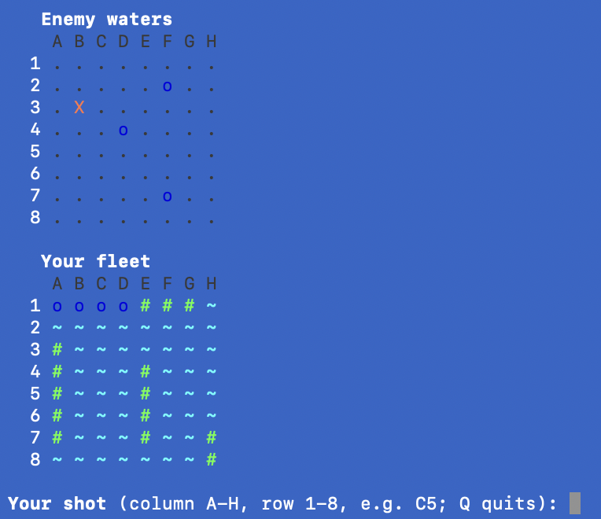

# Battleship, in Malbolge

A complete, playable game of Battleship whose entire rule set, computer
opponent, and board rendering run inside [Malbolge](https://en.wikipedia.org/wiki/Malbolge)
&mdash; a language designed to be almost impossible to program. You play in your
terminal against a computer that hunts your fleet; every decision it makes is
computed by a Malbolge program.

<p align="center"></p>

*The game running in a macOS terminal.*

## Quick start

You need a C compiler, Python 3, git, flex and bison 3 (macOS: `xcode-select --install` and `brew install bison`). Then:

```sh
cd programs/battleship
make play
```

The first `make` builds the interpreter, downloads and builds the LMFAO assembler into `tools/`, compiles the game to HeLL and assembles it (about 30 seconds in all). Later runs go straight to the game.

After `make`, you can also start a game with `python3 launcher.py`, or replay a particular deal with `python3 launcher.py --seed 42`.

## How to play

The launcher places both fleets at random: a 5-, 4-, 3- and 2-cell ship each, never touching. Loading them into the Malbolge program takes about 15 seconds; then the boards appear.

- **Enemy waters** (top) is where you shoot. `.` is unknown water, `X` a hit, `o` a miss.
- **Your fleet** (bottom) shows your ships as `#`, open water as `~`, and the computer's shots as `X` and `o`.
- Type a cell as column letter then row number, such as `C5` or `c5`, and press Enter. Firing at a cell you already tried just asks again.
- The computer answers with its own shot. Press Enter to continue to the next turn.
- Sink all 14 enemy ship cells before the computer sinks yours. `Q` (or Ctrl-D) quits.

The game needs about 4 GB of RAM while it runs, because the assembled program is about 180 MB of Malbolge.

## Why this is hard

Malbolge has no variables, no functions, and no arithmetic you can just write
down: every instruction encrypts itself after it runs, the three-valued "crazy"
operator is its only logic gate, and in the Turing-complete *Unshackled*
variant the machine's word size is unknown and grows as the program runs. There
is also **no random number generator, no command-line arguments, and no file
access**. Most published Malbolge programs are a few lines long; a few large
ones (a Lisp, a lambda-calculus evaluator) exist but are tens of megabytes and
run for minutes.

This project builds a real, interactive game on that substrate.

## How it works

Everything that *is* the game runs in Malbolge Unshackled:

- **State** is held in self-restoring two-state code cells ("flags"). Bytes,
  an 8&times;8 board for each side, hit counters, and the AI's memory are all
  built from flags.
- **Input** is decoded width-independently: each keypress is turned into an
  8-bit code by a 243-way jump table, so it works whatever rotation width the
  interpreter happens to choose.
- **The computer opponent** plays *hunt and target*: it sweeps the board until
  it hits a ship, then tries the cells around that hit before sweeping on. This logic is compiled to Malbolge, not done on the host.
- **Rendering** is ANSI colour text, drawn by Malbolge `OUT` instructions.

The only thing the host does is the one thing Malbolge cannot: a thin Python
**launcher** places two random fleets (Malbolge has no RNG) and streams them to
the program's standard input before play begins. After that, the launcher just
forwards your keystrokes.

The game is written in a tiny structured language (bits, `if`/`while`, counters,
indexed board access) that a small compiler in `compiler/` lowers to **HeLL**,
Matthias Lutter's Malbolge assembly, which
[LMFAO](https://github.com/esoteric-programmer/LMFAO) assembles into a Malbolge
Unshackled program.

## Building by hand

`make` uses an `lmfao` from your PATH if you have one, or `make LMFAO=/path/to/lmfao`. The assembled program (`game/battleship.mu`, about 180&nbsp;MB) is a build artifact and is not checked in; neither is the downloaded LMFAO.

## Layout

```
compiler/   the little-language -> HeLL compiler
  backend.py  control-flow graph and flag machine -> HeLL
  getc.py     width-independent character input
  lang.py     bits, if/while, counters, indexed board access
  battleship.py  the game itself
launcher.py  places random fleets, streams them in, bridges your keyboard
docs/        the screenshot above
tools/mu.c   a Malbolge Unshackled interpreter (for standalone play)
Makefile
```

## Credits

Built by East Agile as part of our Malbolge toolchain. MIT licensed.

HeLL and the LMFAO assembler are by Matthias Lutter. `tools/mu` is a vendored copy of the shared interpreter for standalone play; once the
Rust interpreter lands at the repo root (`interpreter/`), the Makefile's `MU`
variable should point at it and `tools/mu.c` can be dropped.
